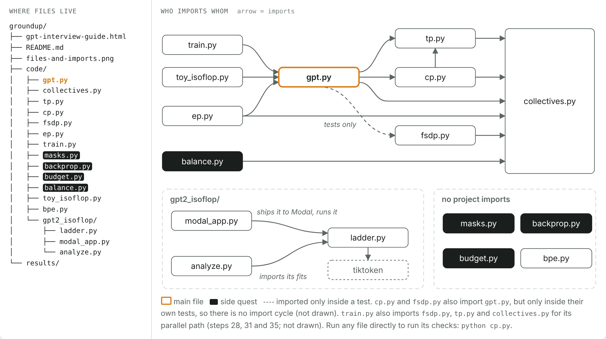

# groundup

Models built from the ground up, one diff at a time. First: a GPT, from attention through training to 3D parallelism and scaling laws.

Open `gpt-interview-guide.html` in a browser (works offline). Its 41 interview-style steps build the files in `code/`, one change at a time.

## Run

- **Any file:** `cd code && python <file>.py` runs that file's checks. The parallel ones spawn CPU processes, so no GPU is needed.
- **Parity run (steps 28, 31 and 35):** from `code/`, `python train.py parity=1 out=1gpu.json`, then
  `torchrun --nproc-per-node 8 train.py parity=1 dp=2 cp=2 tp=2 ref=1gpu.json` prints the largest loss
  difference over 200 steps (`--nproc-per-node 2 ... dp=2` for FSDP alone, `4 ... dp=2 tp=2` for 2D).
  Parity runs use bf16 mixed precision, like training, and match 1 GPU to bf16 rounding (~1e-3). Add `device=cuda` on GPUs.
- **On T4 GPUs (Modal), the same checks:** `pip install modal && python3 -m modal setup`, then from `code/`, e.g.
  `modal run modal_run.py --gpus 4 --cmd "collectives.py device=cuda"` (any parallel file; parity runs add
  `--ref`, see each step's How to run it card). T4: $0.59 per GPU-hour, ≈ $0.04–0.31 per check. Written but not yet
  run: every number in the guide comes from CPU processes on gloo.
- **GPT-2 ladder:** from `code/gpt2_isoflop/`:
  1. `modal run modal_app.py --smoke` (≤ 10 min)
  2. `modal run --detach modal_app.py` (H100, about 1 h, ≤ $10)
  3. `python analyze.py isoflop_gpu_full.json`
- **Needs:**
  - `torch`, `numpy` and `einops` for everything
  - `tiktoken` and `regex` for `bpe.py`
  - `scipy` and `matplotlib` for `analyze.py`
  - `modal` for the ladder and for T4 runs

`results/` holds the runs plotted in the guide; `results/parity.json` and `results/parity_raw/` are the parity sweep.
